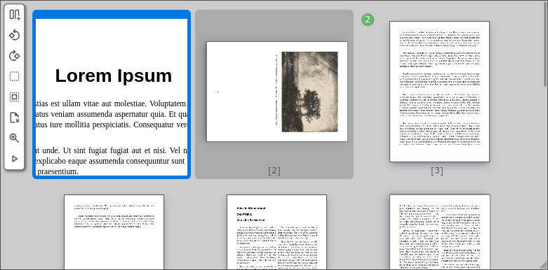

# pdf-reorganizer-service



pdf-reorganizer-service is a simple web service using
[pdf-reorganizer](https://github.com/pdfarranger/pdfarranger)
to help rearrange and split PDFs. It is merely a demo
for that library and not meant to be used as a standalone
application.

pdf-reorganizer-service is heavily inspired
by [PDF-Arranger](https://github.com/pdfarranger/pdfarranger)
and is based on [PDF.js](https://github.com/mozilla/pdf.js).

Reorganization supports:
- Splits
- Removals
- Movements
- Rotations

# Running

Install from source using [cpanm](https://metacpan.org/dist/App-cpanminus)
(best with [perlbrew](https://perlbrew.pl/)):

```shell
cpanm --installdeps .
```

Then run as

```shell
morbo pdf-reorganizer.pl
```

# License

This software bundles [Material Symbols](https://fonts.google.com/icons) from Google, published under the [Apache License 2.0](https://www.apache.org/licenses/LICENSE-2.0.html).
